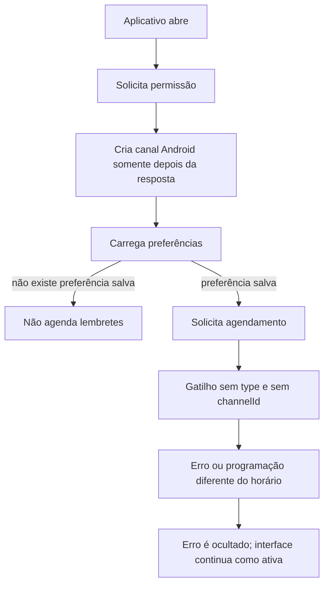

# Análise das notificações

Data: 18/10/2026  
Escopo: notificações locais do Horizonte em Android, com atenção ao Galaxy S23. Não houve alteração funcional nesta análise.

## Diagnóstico

As notificações não têm um agendamento diário válido no código atual. O serviço monta um objeto com `hour`, `minute` e `repeats`, mas a versão instalada de `expo-notifications` exige que o gatilho diário tenha `type: Notifications.SchedulableTriggerInputTypes.DAILY`. O uso de `as any` esconde essa incompatibilidade do TypeScript.

O próprio interpretador instalado só reconhece um lembrete diário quando recebe esse `type`. Sem ele, o objeto cai na alternativa Android de canal, sem horário e sem `channelId`. Portanto os três lembretes não representam a programação escolhida pelo usuário. O botão de teste usa o mesmo padrão incorreto: pede cinco segundos, porém não declara o gatilho `TIME_INTERVAL`.

Além disso, qualquer falha de agendamento é capturada em `scheduleReminder` e transformada apenas em `console.warn`. As funções acima retornam normalmente; a preferência é gravada como ligada e a tela mantém o interruptor ativo. Assim, não há como a pessoa saber que o lembrete não foi criado.

## Fluxo atual

## Achados confirmados

| Prioridade | Evidência | Efeito prático |
| --- | --- | --- |
| Crítica | `services/notificationService.ts` agenda com `{ hour, minute, repeats }` usando `as any`; a biblioteca instalada requer `type: DAILY`. | Os lembretes diário, de despesas e de cartão não são programados no horário configurado. |
| Crítica | O botão “Testar Notificação” envia `{ seconds: 5, channelId: 'default' }` sem `type: TIME_INTERVAL`. | O teste não valida uma entrega após cinco segundos e pode dar uma impressão enganosa. |
| Alta | `scheduleReminder` captura todo erro e não o devolve ao estado ou à interface. | A tela pode informar implicitamente que está tudo ativo mesmo quando a criação falhou. |
| Alta | Em instalação nova, as preferências padrão existem apenas no estado; `loadData` só chama os agendadores quando encontra `@horizonte:notification_prefs` salvo. | O app solicita permissão, mas não cria nenhum lembrete até que a pessoa altere uma opção. |
| Alta | O canal Android é criado depois de consultar/solicitar permissão. A documentação do Expo orienta criá-lo antes do fluxo de permissão no Android 13+. | No S23, a solicitação pode ser inconsistente na primeira execução. |
| Média | Os agendamentos recorrentes não recebem `channelId: 'default'`, embora o canal criado tenha esse identificador. | O comportamento de som, importância e apresentação fica dependente do canal padrão do sistema. |
| Média | “Lembrete de despesas” e “Alerta de cartão” são apenas mensagens genéricas diárias. Não usam vencimento de transação, dia de fechamento nem dia de vencimento do cartão. | O texto promete alertas de pagamento/fatura, mas o produto não implementa alertas por evento financeiro. |
| Média | O interruptor “Ativar notificação” em `app/add-transaction.tsx` nunca é usado no salvamento do lançamento. | A escolha mostrada ao cadastrar uma despesa não tem efeito. |
| Média | `clearAllData` remove preferências locais, mas não cancela os IDs de notificações já entregues ao sistema. | Após apagar os dados, lembretes antigos podem continuar aparecendo. |
| Média | Não existe reconciliação entre IDs guardados no AsyncStorage e notificações efetivamente agendadas; também não há teste do serviço real. | Após atualização, restauração ou limpeza parcial, o app não detecta agendamentos perdidos. |
| Baixa | O layout raiz pede permissão na abertura, antes de uma ação clara da pessoa. | O pedido ocorre fora do contexto dos interruptores e torna a decisão menos compreensível. |

## Configuração Android verificada

- O projeto usa `expo-notifications@0.29.14` e Android com `targetSdk 34`.
- O manifesto do aplicativo em `android/app` não repete `POST_NOTIFICATIONS`, porém o manifesto da dependência `expo-notifications` declara `POST_NOTIFICATIONS` e `RECEIVE_BOOT_COMPLETED`; o Gradle deve mesclá-los no APK. Portanto isso **não foi classificado como causa confirmada** sem inspecionar o APK gerado.
- O `app.json` ainda declara `POST_NOTIFICATIONS` manualmente e não configura o plugin `expo-notifications`. Para lembretes locais, a falha principal está no fluxo de runtime, mas o plugin deve ser configurado antes de uma nova compilação para manter a configuração nativa declarativa.
- Em Android 12+ notificações de horário exato precisam de tratamento próprio para `SCHEDULE_EXACT_ALARM`; em Android 14 a permissão começa negada em instalações novas. Como o S23 pode executar Android 14, o horário poderá atrasar mesmo depois da correção básica, caso o produto exija precisão de minuto. A permissão não deve ser pedida sem validar a necessidade e a política da loja.

A [documentação oficial do Expo Notifications](https://docs.expo.dev/versions/latest/sdk/notifications/) confirma a criação prévia de canal no Android 13+, as exigências de alarmes exatos no Android 12+ e a configuração nativa por plugin/recompilação.

## Sequência recomendada de correção

1. Criar uma única rotina de preparação: criar/confirmar o canal Android, consultar a permissão e só então solicitar autorização quando a pessoa ativar notificações.
2. Substituir o gatilho recorrente por `type: DAILY`, com `hour`, `minute` e `channelId: 'default'`. Corrigir o teste para `type: TIME_INTERVAL`, `seconds: 5` e o mesmo canal.
3. Fazer o agendador retornar um resultado explícito ou lançar o erro. Atualizar a preferência somente depois do sucesso e mostrar uma mensagem útil quando não for possível agendar.
4. Após a primeira permissão concedida, persistir as preferências e criar os lembretes padrão, ou iniciar todos desligados até a pessoa escolhê-los.
5. Ao limpar todos os dados, cancelar os três agendamentos antes de apagar os IDs persistidos. Na restauração, preparar permissão e reconciliar IDs.
6. Decidir o produto esperado: manter lembretes genéricos diários e ajustar os textos, ou implementar alertas por vencimento de despesa e de fatura. Ligar ou remover o interruptor atualmente inoperante do cadastro.
7. Criar testes do serviço para o formato dos três gatilhos, falha de permissão, falha de agendamento, instalação nova, limpeza e restauração.
8. Gerar um APK novo e validar no S23: permissão do sistema, presença do canal “Lembretes Padrão”, teste de cinco segundos, três horários recorrentes, reinício do aparelho e modo economia de bateria.

## Limitação da análise

Não havia APK em execução nem acesso ao Galaxy S23 nesta etapa. Por isso não foi possível inspecionar a permissão concedida, o canal criado no aparelho ou o efeito das configurações Samsung de economia de bateria. As falhas de formato e de fluxo acima foram confirmadas diretamente no código e na biblioteca instalada.

